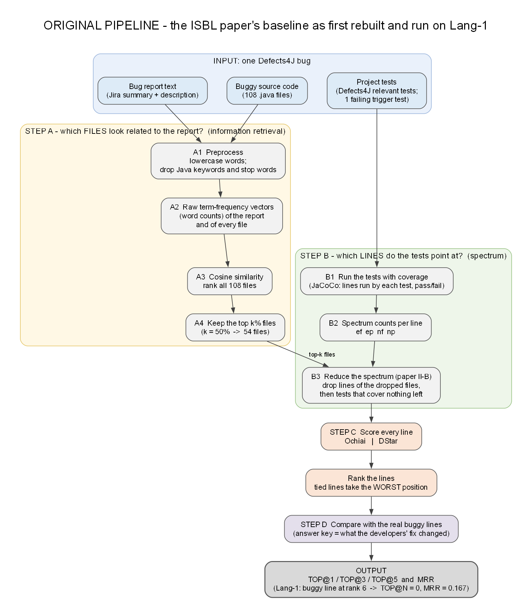
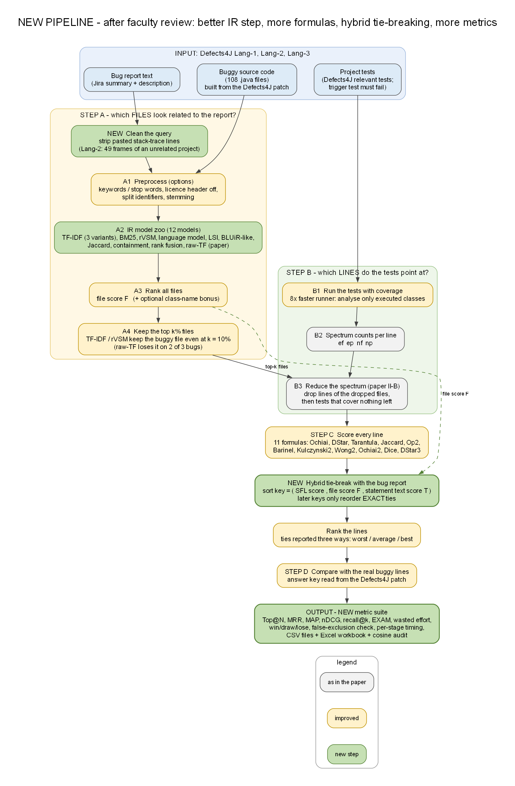
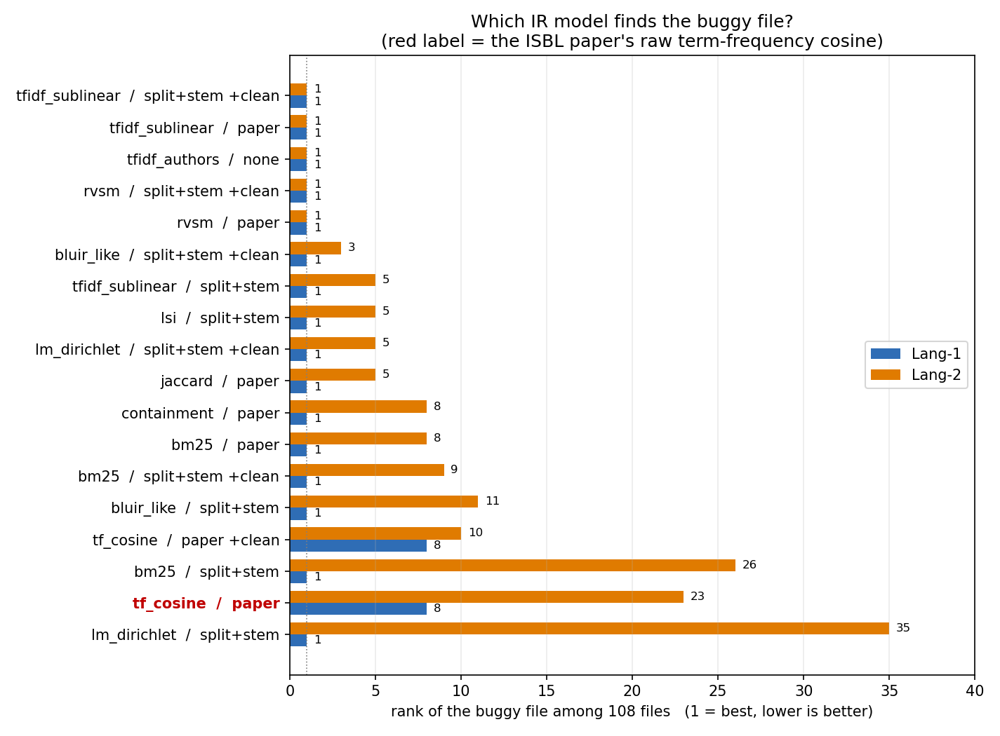
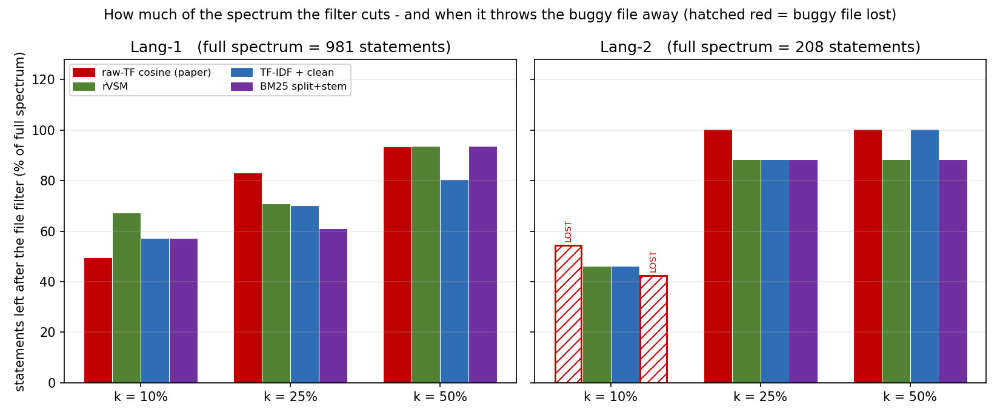
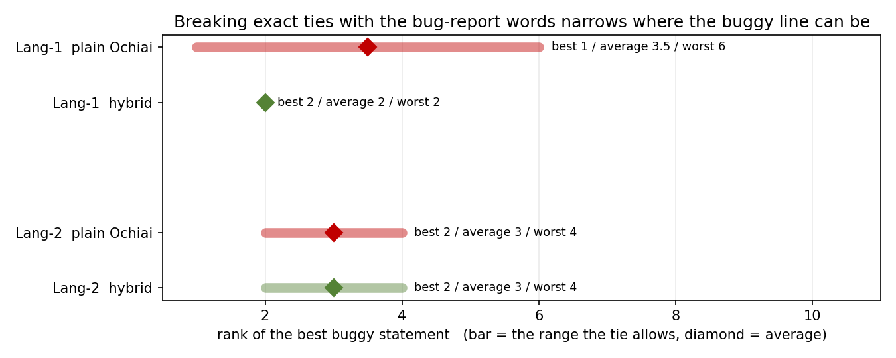

# Finding the buggy line automatically: what we built, what we changed, and what we found

**Project:** reproduction and improvement of *"Statement-level Software Bug Localization based on Information Retrieval and Spectrum"* (ISBL; Li, Yue, Lan, Cui; IEEE SMC 2023)
**Data:** Defects4J v1.4.0, Apache Commons Lang bugs **Lang-1** and **Lang-2** (Lang-3 is summarised in `docs/experiments.md`)
**Date of results:** 2026-10-27  |  **Platform:** Windows 11, JDK 8, Python 3.7 and 3.12, no WSL

> **Honest status.** The pipeline works end to end on real bugs and is tested (104 unit tests). The paper's headline numbers are **not** reproduced, because that needs all 373 bugs and we ran three (this report details two). Differences between methods below are small counts on very few bugs, so treat them as indications, not proof. No parameter was tuned on these bugs.

---

## 1. One-page summary

- **The problem.** A program has thousands of lines and one of them is wrong. Finding it by hand is slow, so researchers rank lines by "how suspicious" they are.
- **The paper's idea (ISBL).** Use two clues. *Clue 1:* the **bug report** (text written by a user) tells us which **files** look related. *Clue 2:* the **tests** (which lines each test ran, and which test failed) tell us which **lines** are suspicious. Filter the files first, then rank only the lines inside the likely files.
- **Step 1 of our work (the original pipeline).** We rebuilt that method from the paper and ran it on Lang-1: it works, but the buggy line is ranked 6th because six lines tie.
- **Step 2 (after faculty review).** We were asked to add more metrics, check the cosine similarity properly, try TF-IDF and better IR measures, read the literature, and run other Lang bugs. We did all of that, on Lang-1, Lang-2 and Lang-3.
- **What we found**
  1. The cosine arithmetic is correct (it matches scikit-learn and SciPy to 1e-16). The weak point is the **weighting**: with raw word counts, ordinary words ("not", "string", "java") decide the ranking. TF-IDF-style weighting fixes this: the main variants (TF-IDF, rVSM) rank the buggy file **1st** on Lang-1 and Lang-2, where the paper's raw-count cosine ranks it **8th** and **23rd**.
  2. A better file ranking lets the filter be **more aggressive without losing the bug**: at k = 10% the paper's IR throws the buggy file away on Lang-2 (the bug can then never be found), while TF-IDF and rVSM keep it.
  3. Nine other spectrum formulas give the **same** ranking as Ochiai: lines run by exactly the same tests have exactly the same counts, and no formula can tell them apart.
  4. Using the bug report's words to break those exact ties moved the buggy line on Lang-1 from "somewhere between 1st and 6th" (average 3.5) to **2nd**; it changed nothing on Lang-2.
  5. Almost all run time (98%) was one slow step, collecting coverage; we made it about **8× faster** with identical output.

---

## 2. Vocabulary in plain words

| Term | Meaning |
|---|---|
| **Bug report** | The written complaint (Jira title + description), e.g. *"NumberUtils does not handle Long Hex numbers"* |
| **Statement / line** | One executable line of Java code; what we want to rank |
| **Test** | A small program that checks one behaviour; it **passes** or **fails**. Each bug has at least one failing test |
| **Coverage / spectrum** | For every test, the set of lines it ran. Together with pass/fail this is the *spectrum* |
| **IR (information retrieval)** | Ranking files by how similar their words are to the words of the bug report |
| **SFL (spectrum-based fault localisation)** | Ranking lines by suspicion computed from the spectrum with a formula (Ochiai, DStar, ...) |
| **k** | The share of top-ranked files kept as "suspicious" (k = 50% of 108 files = 54 files) |
| **Tie** | Several lines with exactly the same score; their true order is unknown |
| **Answer key** | The lines the developers' real fix changed; used **only to grade** the result, never by the method |

---

## 3. The original pipeline



*(Drawn by us from the paper's description and our first implementation; the paper's own Figure 1 is not reproduced here.)*

| Stage | What it does | Where (repo) |
|---|---|---|
| Input | Bug report, buggy source (108 files), project tests | `data/bug_reports/`, `work-lang/` |
| A1-A3 | Lowercase words, drop Java keywords and stop words, count words, cosine similarity between report and every file | `isbl/baseline/ir.py` |
| A4 | Keep the top k% of files | `ir.select_top_k` |
| B1-B2 | Run tests under JaCoCo, record lines per test, build `ef ep nf np` per line | `isbl/baseline/java/CoverageRunner.java`, `spectrum.py` |
| B3 | Paper section II-B: drop lines of dropped files, then tests that cover nothing left | `spectrum.reduce_tests` |
| C | Ochiai or DStar per line; rank lines; ties counted at the **worst** position | `sfl.py`, `ranking.py` |
| D | Compare with the answer key: TOP@1/3/5, MRR | `isbl/evaluation/metrics.py` |

**First result (Lang-1, k = 50%):** the buggy file was ranked 8th of 108 (still kept), six lines tied at the top score (three of them buggy), so the buggy line sits at rank 6 with worst-case ties: TOP@1/3/5 = 0/0/0, MRR = 0.167. ISBL (with filtering) and plain Ochiai/DStar gave the same ranking.

## 4. What the faculty review asked, and what we did

| Request | Done |
|---|---|
| More metrics for comparison | a file-level and a statement-level metric suite (section 6) |
| Check the cosine similarity properly | `scripts/run/cosine_audit.py` (section 9) |
| Try TF-IDF and more proper IR measures | 12 models in `isbl/baseline/ir_models.py` (section 6.3) |
| Find relevant papers and add their metrics | `docs/literature.md`: 11 sources (abstracts and snippets only, not full papers) |
| Run on other Lang bugs | Lang-2 and Lang-3 prepared with `scripts/bugs/prepare_lang_bug.py` |
| Find more types of bugs | Lang-1 = wrong condition; Lang-2 and Lang-3 = *omission* bugs (a needed check is missing) |

## 5. The new pipeline



| Part | Original | New |
|---|---|---|
| Query | whole report as written | **stack-trace lines removed** (Lang-2's report holds 49 frames from an unrelated project) |
| Word preparation | keywords + stop words removed | plus options: licence header off, identifiers split (`createNumber` -> create, number), stemming |
| File ranking | raw word-count cosine | **12 IR models** (TF-IDF, BM25, rVSM, language model, LSI, BLUiR-like, rank fusion, ...) and an optional class-name bonus |
| Filter | k = 50% | same mechanism, but the better IR keeps the buggy file at k = 10% |
| Coverage | analysed every class after every test | analyses **only executed classes**: about 8× faster, identical output |
| Line scoring | Ochiai, DStar | **11 formulas** |
| Ties | counted at the worst position | reported **worst / average / best**; **hybrid tie-break** with bug-report words |
| Metrics | TOP@1/3/5, MRR | full suite (below) + false-exclusion check + per-stage timing + CSV/Excel outputs |
| Bugs | Lang-1 | Lang-1, Lang-2, Lang-3, answer key read straight from the Defects4J patch |

---

## 6. The metrics, with formulas and small examples

### 6.1 The spectrum counts and the line-scoring formulas

For **one line** we count tests:

| Symbol | Meaning |
|---|---|
| `ef` | failing tests that **run** the line |
| `ep` | passing tests that run the line |
| `nf` | failing tests that do **not** run the line |
| `np` | passing tests that do not run the line |

**Toy example.** Four tests (T1 fails) and three lines; a 1 means "the test ran the line".

| test | result | line 1 | line 2 | line 3 |
|---|---|---|---|---|
| T1 | **FAIL** | 1 | 1 | 0 |
| T2 | pass | 1 | 0 | 1 |
| T3 | pass | 1 | 0 | 0 |
| T4 | pass | 0 | 0 | 1 |
| **(ef, ep, nf, np)** | | (1, 2, 0, 1) | (1, 0, 0, 3) | (0, 2, 1, 1) |

The idea: a line run by the failing test and by few passing tests is suspicious.

```
Ochiai   = ef / sqrt( (ef + nf) * (ef + ep) )            line 1: 1/sqrt(1*3) = 0.577    line 2: 1/sqrt(1*1) = 1.0    line 3: 0
DStar(2) = ef^2 / (ep + nf)                              line 1: 1/2 = 0.5              line 2: 1/0 -> infinity (top)  line 3: 0
Tarantula = (ef/(ef+nf)) / ( ef/(ef+nf) + ep/(ep+np) )   line 1: 1/(1+2/3) = 0.6        line 2: 1.0                  line 3: 0
```

Line 2 (only the failing test runs it) is ranked first by all three. The other formulas we added use the same four counts:

| Formula | Expression | Value for the real Lang-1 tie lines (1, 3, 0, 166) |
|---|---|---|
| Ochiai | `ef / sqrt((ef+nf)(ef+ep))` | 0.500 |
| DStar (2) / DStar (3) | `ef^2/(ep+nf)` / `ef^3/(ep+nf)` | 0.333 / 0.333 |
| Tarantula | see above | 0.983 |
| Jaccard | `ef / (ef+nf+ep)` | 0.250 |
| Sorensen-Dice | `2ef / (2ef+nf+ep)` | 0.400 |
| Kulczynski2 | `0.5 * (ef/(ef+nf) + ef/(ef+ep))` | 0.625 |
| Op2 | `ef - ep/(ep+np+1)` | 0.982 |
| Barinel | `1 - ep/(ep+ef)` | 0.250 |
| Wong2 | `ef - ep` | -2 |
| Ochiai2 | `ef*np / sqrt((ef+ep)(nf+np)(ef+nf)(ep+np))` | 0.496 |

All of them depend only on `(ef, ep, nf, np)`. **Two lines with the same four numbers get the same score from every formula**; that is why switching formulas could not fix the ties below.

### 6.2 Ties and how ranks are counted

Six lines share the top score. They occupy positions 1 to 6, but nobody knows their order. Three ways to count:

| Rule | Rank given to each of the six | Meaning |
|---|---|---|
| **worst** | 6 | the bug is the last of the tied lines |
| **average** | 3.5 | expected position |
| **best** | 1 | the bug is the first of the tied lines |

The paper does not say which rule it uses, so we report all three. Results below use *worst* for TOP@N (the cautious choice) and *average* for MRR/MAP/nDCG/EXAM unless the column says otherwise (`w`/`a`/`b`).

### 6.3 IR models for ranking files (Step A)

Each file and the report are turned into "bags of words". A score says how similar they are.

**Cosine similarity** (what the paper uses, on raw word counts):

```
cos(q, d) = sum( q_t * d_t ) / ( sqrt(sum q_t^2) * sqrt(sum d_t^2) )        value between 0 and 1
```

Example: report `q = (hex 1, common 1)`; file A is "common" written 10 times, file B is "hex" once. Cosine A = 10 / (1.414 x 10) = 0.707, cosine B = 1 / (1.414 x 1) = 0.707 : **a tie**, although B contains the rare, informative word and A only repeats an ordinary one.

**TF-IDF** weights each word by how rare it is across files, so ordinary words count less:

```
idf(t)    = ln( (1 + N) / (1 + df(t)) ) + 1          N = number of files, df = files containing the word
weight    = (1 + ln tf) * idf(t)                      "sublinear" tf; then cosine as above
```

In the example (N = 3): idf(common) = 1.288 (in 2 files), idf(hex) = 1.693 (in 1 file). TF-IDF cosine: A = **0.605**, B = **0.796**: now B wins. (The authors' script uses `idf = ln(N/df) + 1` without smoothing; we kept that as `tfidf_authors`.)

**BM25** (Okapi) also rewards rare words but limits the credit for repeating a word and corrects for file length:

```
BM25(q,d) = sum over query words t of  idf(t) * tf*(k1+1) / ( tf + k1*(1 - b + b*|d|/avgdl) ),   k1 = 1.2, b = 0.75
idf(t)    = ln( 1 + (N - df + 0.5) / (df + 0.5) )
```

Example: N = 100, df = 10, tf = 3, file of average length: idf = 2.264, tf-part = 3x2.2/(3+1.2) = 1.571, score = **3.557**. The same tf = 3 in a file twice as long: **2.930**.

**rVSM** (BugLocator): `rVSM = g(length) * cosine` with log-tf and `idf = ln(N/df)`, and `g = 1/(1+e^(-N(len)))` where `N(len)` scales file length to 0..1: g = 0.5 for the shortest file and 0.731 for the longest (a mild bonus for big files).

**Dirichlet language model:** `score = sum over query words ln( (tf + mu*p(t)) / (|d| + mu) )`, mu = 2000, `p(t)` = share of the word in all files. Example: tf = 2, |d| = 100, p = 0.01 -> ln(22/2100) = -4.559 (less negative = better).

**Jaccard** `|Q and D| / |Q or D|` and **containment** `|Q and D| / |Q|`: example Q = {a, b}, D = {a, b, c}: 0.667 and 1.0. **LSI** projects TF-IDF vectors onto 50 latent directions (SVD) and compares there. **BLUiR-like** computes BM25 separately between {title, description} and {class name, method names, identifiers, comments} of each file and adds the scores. **Rank fusion (RRF)** `score = sum 1/(60 + rank_i)`: a file ranked 4th by two models (0.03125) beats one ranked 1st by one and 10th by another (0.03068).

**Preparation options.** *split identifiers*: `createNumber` -> `createnumber`, `create`, `number`. *stem*: `numbers` -> `number`. *clean*: delete stack-frame lines (`at pkg.Class.method(File.java:12)`) from the report. *name bonus*: add to a file's score if its class name appears as a word in the report.

**Choosing the files.** `kept = ceil(k * N)` files: k = 10% of 108 files is **11 files**, k = 50% is **54**.

**IR diagnostics we log.**

```
percentile = (rank of the buggy file) / N         the smallest k that would keep it   (Lang-1: 8/108 = 0.074)
gap        = cosine(rank 1) - cosine(rank 2)      small gap = the model is not decisive
entropy    = - sum p_i log2 p_i,   p_i = score_i / sum(scores)      max for 108 equal scores = 6.75 bits; low = confident
```

### 6.4 Evaluation metrics

**File level** (did the IR step find the right file?): the buggy file's rank `r` among N files.

| Metric | Formula | Small example |
|---|---|---|
| **Top@N** | 1 if `r <= N`, else 0 (summed over bugs) | ranks (1, 4, 12): Top@1 = 1, Top@3 = 1, Top@5 = 2 |
| **MRR** | mean of `1/r` | ranks 1, 3, 5: (1 + 1/3 + 1/5)/3 = **0.511** |
| **AP / MAP** | mean over buggy items of `i / rank_i` (÷ number of buggy items; one never found counts 0) | buggy at ranks 2 and 4: (1/2 + 2/4)/2 = **0.5**; with a third one never found: 1.0/3 = **0.333** |
| **nDCG@k** | `sum 1/log2(rank+1)` for buggy items with rank <= k, divided by the best possible | one buggy item at rank 3: 1/log2(4) = **0.5** |
| **recall@k% of files** | share of buggy files inside the top k% of files | buggy file rank 23 of 108, k = 10%: top 11 -> **0** (lost) |
| **precision@k** | buggy items in the top k, divided by k | ranks {1, 3, 9}, k = 5: 2/5 = **0.4** |

**Statement level** (did we find the right line?): rank of the **best-ranked** buggy line.

| Metric | Formula | Example |
|---|---|---|
| **TOP@N** | number of bugs whose best buggy line has rank `<= N` | Lang-1 worst-case rank 6: TOP@1/3/5 = 0/0/0 |
| **MRR** | mean of `1/rank` | rank 6 -> 0.167; average rank 3.5 -> 0.286 |
| **MAP, nDCG@10** | as above, over **all** buggy lines (Lang-1 has three) | |
| **recall@10** | buggy lines in the top 10 / all buggy lines | ranks {1, 3, 9} of 4 buggy lines: 3/4 |
| **EXAM** | `rank / total statements` : share of the list a developer reads | rank 6 of 981 = **0.0061** (worst) or 3.5/981 = **0.0036** (average) |
| **wasted effort** | `rank - 1` : lines read before the bug | 5 (worst) or 2.5 (average) |
| **win / draw / lose** | per bug, compare two methods' best rank | A = (2, 5, none), B = (3, 5, 4): 1 win, 1 draw, 1 loss |
| **bootstrap CI, Wilcoxon p** | uncertainty of the mean / paired test | reported for completeness; with 2-3 bugs they say nothing |

**False exclusion.** If the buggy file is not among the kept files, its lines are not in the reduced spectrum, so the bug can **never** be found. We count, per setting, how many bugs lose their buggy file ("lost") and how much of the spectrum is removed ("cut"). This is the failure the paper itself describes for Math-51.

### 6.5 The hybrid tie-break (our extension)

Lines with identical `(ef, ep, nf, np)` cannot be separated by the tests. The bug report can: lines that mention the report's words are more likely to be the bug.

```
T(line) = sum of idf(t)  over the words t shared by the line's source text and the bug report
F(file) = the IR score of the line's file, scaled to 0..1
sort key = ( SFL score , F , T )     compared left to right: F and T only reorder EXACT ties of the SFL score
```

Real example, the six tied lines of Lang-1 (all have Ochiai 0.5, same file so same F):

| Line | Source text | Buggy? | T | Rank (worst-case) |
|---|---|---|---|---|
| 474 | `return createInteger(str);` | no | 7.007 | 1 |
| **467** | `final int hexDigits = str.length() - pfxLen;` | **yes** | 5.979 | **2** |
| **468** | `if (hexDigits > 16) { // too many for Long` | **yes** | 4.771 | 4 (tied with 471) |
| **471** | `if (hexDigits > 8) { // too many for an int` | **yes** | 4.771 | 4 |
| 462 | `pfxLen += pfx.length();` | no | 1.208 | 5 |
| 463 | `break;` | no | 0.000 | 6 |

The best buggy line moves from "rank 1 to 6 (average 3.5)" to rank **2**. It is not perfect: line 474 is not buggy but shares the word `createInteger` with the report, so it comes first. A plain **linear blend** (`0.4*SFL + 0.3*F + 0.3*T`, each scaled to 0..1) was also tried; it can overrule the tests, and on Lang-2 it made things worse (below).

---

## 7. Results: Lang-1 (LANG-747, a wrong-condition bug)

**The bug.** `NumberUtils.createNumber("0x80000000")` crashes: the code decides int vs long by counting hex digits instead of checking the value. **Answer key:** `NumberUtils.java` lines 467, 468, 471. **Setup:** 108 files, 173 tests (1 failing: `TestLang747`), 981 statements in the spectrum, report of 662 characters.

**Standard pipeline, k = 50% (paper-style IR).**

| Method | Tests | Statements | IR rank of buggy file | Tie group at the buggy line | Rank w / a / b | TOP@1/3/5 (w) | MRR (w) |
|---|---|---|---|---|---|---|---|
| Ochiai | 173 | 981 | 8 | 6 lines (3 buggy) | 6 / 3.5 / 1 | 0 / 0 / 0 | 0.167 |
| ISBL + Ochiai | 170 | 913 | 8 | 6 lines (3 buggy) | 6 / 3.5 / 1 | 0 / 0 / 0 | 0.167 |
| DStar, ISBL + DStar | same as Ochiai | | | | | | |

IR facts for the buggy file: cosine 0.1198 against 0.1560 for the top file (`Validate.java`), gap 0.0024, entropy 6.65 of at most 6.75 bits, matrix density 1.4% (only 1.4% of test-line cells are 1).

**File level: rank of the buggy file (Lang-1 | Lang-2).**

| IR configuration | Lang-1 | Lang-2 |
|---|---|---|
| **raw-TF cosine (the paper)** | **8** | **23** |
| raw-TF cosine + clean query | 8 | 10 |
| TF-IDF, authors' script (no preprocessing) | 1 | 1 |
| TF-IDF sublinear / paper preprocessing | 1 | 1 |
| TF-IDF sublinear / split + stem | 1 | 5 |
| TF-IDF sublinear / split + stem + clean | 1 | 1 |
| rVSM / paper | 1 | 1 |
| rVSM / split + stem | 1 | 2 |
| rVSM / split + stem + clean | 1 | 1 |
| BM25 / paper | 1 | 8 |
| BM25 / split + stem | 1 | 26 |
| BM25 / split + stem + clean | 1 | 9 |
| Dirichlet language model / split + stem | 1 | 35 |
| Dirichlet language model / split + stem + clean | 1 | 5 |
| LSI / split + stem | 1 | 5 |
| BLUiR-like / split + stem | 1 | 11 |
| BLUiR-like / split + stem + clean | 1 | 3 |
| Jaccard / containment | 1 / 1 | 5 / 8 |
| rank fusion (BM25, TF-IDF, rVSM) | 1 | 6 |
| TF-IDF or BM25, split + stem, + class-name bonus | 1 | 1 |



**Filtering at several k: Lang-1** (bars show the share of the 981 statements that remain; the buggy file was never lost on Lang-1).



| IR model | k = 50% | k = 25% | k = 10% |
|---|---|---|---|
| raw-TF cosine (paper) | 913 (93%) | 811 (83%) | 481 (49%) |
| rVSM / paper | 914 | 692 | 656 |
| TF-IDF sublinear / split+stem + clean | 786 (80%) | 684 (70%) | 558 (57%) |
| BM25 / split+stem | 914 | 594 | 558 |

**Statement level: Lang-1** (`w` = worst-case ties, `a` = ties averaged; every row keeps all three buggy lines in the spectrum).

| Method | Stmts | Tests | Best buggy rank w / a / b | TOP@1/3/5 (w) | MRR w | MRR a | MAP a | nDCG@10 a | EXAM a | Wasted a |
|---|---|---|---|---|---|---|---|---|---|---|
| SFL: Ochiai (= DStar, Tarantula, Jaccard, Op2, Barinel, Kulczynski2, Ochiai2, Dice, DStar3) | 981 | 173 | 6 / 3.5 / 1 | 0/0/0 | 0.167 | 0.286 | 0.571 | 0.649 | 0.0036 | 2.5 |
| SFL: Wong2 | 981 | 173 | 716 / 628 / 540 | 0/0/0 | 0.001 | 0.002 | 0.003 | 0.000 | 0.6402 | 627 |
| ISBL, raw-TF (paper), k = 50% | 913 | 170 | 6 / 3.5 / 1 | 0/0/0 | 0.167 | 0.286 | 0.571 | 0.649 | 0.0036 | 2.5 |
| ISBL, TF-IDF + clean, k = 50% | 786 | 168 | 6 / 3.5 / 1 | 0/0/0 | 0.167 | 0.286 | 0.571 | 0.649 | 0.0036 | 2.5 |
| ISBL, TF-IDF + clean, k = 10% | 558 | 150 | 6 / 3.5 / 1 | 0/0/0 | 0.167 | 0.286 | 0.571 | 0.649 | 0.0036 | 2.5 |
| Hybrid, file score F only (`tie_file`) | 786 | 168 | 6 / 3.5 / 1 | 0/0/0 | 0.167 | 0.286 | 0.571 | 0.649 | 0.0036 | 2.5 |
| **Hybrid, statement text (`tie_text`)** | 786 | 168 | **2 / 2 / 2** | **0/1/1** | **0.500** | **0.500** | **0.643** | **0.729** | **0.0020** | **1.0** |
| Hybrid, linear blend (a = 0.3, b = 0.3) | 786 | 168 | 2 / 2 / 2 | 0/1/1 | 0.500 | 0.500 | 0.643 | 0.729 | 0.0020 | 1.0 |

**Reading Lang-1.**
1. The paper's IR ranks the buggy file 8th; every idf-weighted model ranks it 1st.
2. No formula, and no amount of filtering, changes the statement ranking: the six tied lines are in the buggy file, and exactly the same four tests (one failing, three passing) run all six.
3. Filtering with a better IR still pays off: it removes 20% of the statements at k = 50% and 43% at k = 10% (the paper's IR: 7% and 51% - and on Lang-2 the latter throws the bug away, see below), with the ranking unchanged.
4. Breaking the exact ties with the report's words moves the best buggy line from 1-to-6 (average 3.5) to 2nd, and TOP@3 from 0 to 1.



---

## 8. Results: Lang-2 (LANG-879, an omission bug)

**The bug.** `LocaleUtils.toLocale(...)` does not reject a locale string containing `#` (new in Java 7, e.g. `ja_JP_JP_#u-ca-japanese`). The fix **adds** a check; the buggy version is **missing** it. The answer key for an omission is the first line after the gap: **line 92** (`final int len = str.length();`). **Setup:** 108 files, only 14 tests (the Defects4J relevant tests are one class, `LocaleUtilsTest`; the failing test is `testParseAllLocales`), 208 statements in the spectrum. The Jira report is 8,265 characters and contains **49 stack-frame lines from an unrelated project** (Maven Surefire, TestNG, `com.scispike...`), which is pure noise for retrieval.

**Standard pipeline, k = 50% (paper-style IR).**

| Method | Tests | Statements | IR rank of buggy file | Tie group at the buggy line | Rank w / a / b | TOP@1/3/5 (w) | MRR (w) |
|---|---|---|---|---|---|---|---|
| Ochiai | 14 | 208 | **23** | 3 lines (1 buggy) | 4 / 3.0 / 2 | 0 / 0 / 1 | 0.250 |
| ISBL + Ochiai | 14 | 208 | 23 | 3 lines (1 buggy) | 4 / 3.0 / 2 | 0 / 0 / 1 | 0.250 |

IR facts: cosine of the buggy file 0.1112, but the top file (`JavaVersion.java`) scores 0.3169; the filter removes **0%** of the statements at k = 50%, because the 14 tests touch few files.

**File level**: see the combined table in section 7 (right column). Highlights for Lang-2: the paper's cosine ranks `LocaleUtils.java` **23rd**; removing the pasted trace moves it to 10th; every TF-IDF/rVSM variant with the clean query ranks it **1st**. Identifier splitting plus stemming is **not** automatically better: TF-IDF drops from 1st to 5th, rVSM from 1st to 2nd, BM25 from 8th to 26th when switched on.

**False exclusion on Lang-2 (statements left, and whether the buggy line survived).**

| IR model | k = 50% | k = 25% | k = 10% |
|---|---|---|---|
| raw-TF cosine (paper) | 208, kept | 208, kept | 113, **LOST** (only 1 test left; bug cannot be found) |
| rVSM / paper | 183, kept | 183, kept | 95, kept |
| TF-IDF sublinear / split+stem + clean | 208, kept | 183, kept | 95, kept |
| BM25 / split+stem | 183, kept | 183, kept | 88, **LOST** |
| Dirichlet LM / split+stem | 120, kept | 25, **LOST** | 25, **LOST** |


**Statement level: Lang-2.**

| Method | Stmts | Tests | Best buggy rank w / a / b | TOP@1/3/5 (w) | MRR w | MRR a | MAP a | nDCG@10 a | EXAM a | Wasted a |
|---|---|---|---|---|---|---|---|---|---|---|
| SFL: Ochiai (= the 9 equivalent formulas) | 208 | 14 | 4 / 3.0 / 2 | 0/0/1 | 0.250 | 0.333 | 0.333 | 0.500 | 0.0144 | 2.0 |
| SFL: Wong2 | 208 | 14 | 204 / 201 / 198 | 0/0/0 | 0.005 | 0.005 | 0.005 | 0.000 | 0.9663 | 200 |
| ISBL, raw-TF (paper), k = 50% / 25% | 208 | 14 | 4 / 3.0 / 2 | 0/0/1 | 0.250 | 0.333 | 0.333 | 0.500 | 0.0144 | 2.0 |
| ISBL, raw-TF (paper), **k = 10%** | 113 | 1 | **buggy line lost** | 0/0/0 | **0** | **0** | **0** | **0** | - | - |
| ISBL, TF-IDF + clean, k = 50% | 208 | 14 | 4 / 3.0 / 2 | 0/0/1 | 0.250 | 0.333 | 0.333 | 0.500 | 0.0144 | 2.0 |
| ISBL, TF-IDF + clean, **k = 10%** | **95** | 14 | 4 / 3.0 / 2 | 0/0/1 | 0.250 | 0.333 | 0.333 | 0.500 | 0.0144 | 2.0 |
| Hybrid, statement text (`tie_text`) | 208 | 14 | 4 / 3.0 / 2 | 0/0/1 | 0.250 | 0.333 | 0.333 | 0.500 | 0.0144 | 2.0 |
| Hybrid, linear blend (a = 0.3, b = 0.3) | 208 | 14 | 7 / 6.0 / 5 | 0/0/0 | 0.143 | 0.167 | 0.167 | 0.356 | 0.0288 | 5.0 |

**Why the hybrid did not help on Lang-2.** The buggy line 92 ties with lines 89 and 93, none of which shares a word with the report (text score 0). Line 94, `throw new IllegalArgumentException("Invalid locale format")`, is ranked first because only two tests run it; it comes from the validation code that exists in both versions and is *not* the bug. The report does not talk about the missing check in terms of these lines, so there is no signal to break the tie. The linear blend, in contrast, lets file and text scores overrule the tests and **loses** (rank 7).

**Reading Lang-2.**
1. A noisy report (49 foreign stack frames) breaks the paper's raw-count cosine (rank 23); cleaning plus idf weighting repairs it (rank 1).
2. The benefit of the better IR is **safety at small k**: at k = 10% the paper's IR loses the bug, TF-IDF/rVSM keep it while cutting 54% of the statements.
3. Tie-breaking by words is not a universal fix; it only helps when the buggy lines share words with the report (true on Lang-1, not on Lang-2).

---

## 9. Cosine similarity audit

Question from the review: *is our cosine similarity right?*  Script: `scripts/run/cosine_audit.py`; data: `results/experiments/cosine_audit_*.csv`.

| Check | Lang-1 | Lang-2 |
|---|---|---|
| Largest difference to scikit-learn `cosine_similarity` | 4.2e-17 | 5.6e-17 |
| Largest difference to SciPy cosine distance | 8.3e-17 | 1.1e-16 |
| Same ranking as scikit-learn | yes | yes |
| Values in [0, 1]; self-similarity = 1 | yes; 1.0 | yes; 1.0 |
| Symmetric; unchanged if the query counts are multiplied by 7; zero vector -> 0 | yes | yes |

**Verdict: the arithmetic is right. The weighting is the problem.** Where the top-ranked (wrong) file gets its score:

| Bug | Top file (cosine) | Words that produce its score | Share of the score from words found in > 50% of all files | Buggy file: rank, cosine, top words |
|---|---|---|---|---|
| Lang-1 | `Validate.java` (0.156) | not 69%, string 16%, method 5%, check 4% | **91%** | `NumberUtils.java`: 8, 0.120; not 22%, string 18%, numberutils 16%, integer 11%, hex 8% |
| Lang-2 | `JavaVersion.java` (0.317) | java 84%, org 7%, apache 6% | **99.9%** | `LocaleUtils.java`: 23, 0.111; locale 43%, java 35%, org 6%, apache 5% |

In plain words: raw counts reward ordinary words ("not", "string", and in Lang-2 "java/org/apache" from the pasted trace). TF-IDF gives those words almost no weight. (The paper's stop-word list is not published; ours does not contain "not", which may differ from the authors'.)

---

## 10. Speed: where the time goes

| Stage (Lang-1, 173 tests) | Before | After |
|---|---|---|
| Coverage collection, JVM total | 9.5-9.6 s (JaCoCo re-analysing all classes after every test: 96-98% of it) | **1.15 s** (analyses only executed classes; 73% is still analysis) |
| Throughput | 18 tests / s | **150 tests / s** |
| All other stages together (IR, spectrum, scoring, metrics) | about 0.2 s | about 0.2 s |
| Lang-2 (14 tests) | | 0.54 s JVM total |

The coverage output is **identical** to the slow version (compared line by line on all 403 lines). Running the full Lang test suite (2,280 tests) took 232 s before the change.

## 11. Other findings and quality checks

- **Formulas:** 11 SFL formulas, 9 give identical rankings on Lang-1 and Lang-2; Wong2 is far worse (it ignores normalisation).
- **Tests:** 104 automated unit tests (cosine, TF-IDF checked against scikit-learn, BM25, rVSM, hybrid keys, metrics, answer key, query cleaning, timing) pass on Python 3.7 and 3.12.
- **Preparing a new bug** (Lang-2): find the fixing commit in the Apache history that accepts the Defects4J patch -> check it out -> apply the patch (gives the buggy source) -> compile on JDK 8 -> fetch the Jira report -> run the tests -> **require that the Defects4J trigger test fails**. Two Windows issues were found and fixed: the Defects4J clone had CRLF patch files (normalised to LF), and `TypeUtilsTest` cannot be compiled by javac 8 (excluded, as for Lang-1).
- **Answer key** is read directly from the Defects4J patch; for an omission bug it is the first line after the gap.

## 12. Limits and honest caveats

- **Few bugs.** Three bugs of one project (two detailed here); the paper uses 373 over six projects. Nothing here confirms or contradicts the paper's tables.
- **Post-hoc choice.** `tie_text` looked best among 12 hybrid variants evaluated on the same three bugs; confirm it on more bugs before relying on it. It narrows the uncertainty of a tie; it does not guarantee rank 1 (on Lang-1 the best-case rank 1 became 2).
- **Our own extension.** The hybrid tie-break is not part of the ISBL paper. The BLUiR-like model uses regular expressions, not a Java parser. BugLocator's similar-bug history, stack-trace boosting, call-frequency tie-breaking and learned retrieval were **not** implemented.
- **Assumptions the paper leaves open:** how ties are counted, DStar's exponent (we use 2), its stop-word list.
- **Coverage tool:** JaCoCo line coverage instead of Defects4J's own coverage tooling; only the Defects4J relevant tests are run.
- **Literature scan:** abstracts and search snippets, not the full papers (`docs/literature.md`).

## 13. How to reproduce and where things are

```powershell
cd <path-to-this-repository>
. .\scripts\setup\env.ps1                              # Java 8 + Python 3.7 on the PATH
python -m isbl.baseline.pipeline configs\lang1_k50.json --explain          # standard pipeline, Lang-1 (printed tables)
python -m isbl.baseline.pipeline configs\bugs\Lang-2.json --explain        # same on Lang-2
python scripts\bugs\prepare_lang_bug.py 2 3            # one-time: prepare Lang-2, Lang-3 (Maven + internet)
python scripts\run\cosine_audit.py                     # section 9
python scripts\run\run_experiments.py                  # sections 7-8 tables, about 50 s
envs\modern312\Scripts\python scripts\run\build_excel_experiments.py   # results\Lang-1-2-3_experiments.xlsx
python -m pytest -q tests                              # 104 tests
C:\Users\Prasun\anaconda3\python.exe scripts\run\make_report_figures.py   # charts of this report
dot -Tpng -Gdpi=130 docs\images\pipeline_new.dot -o docs\images\pipeline_new.png   # diagrams (Graphviz)
```

| What | Where |
|---|---|
| IR models, preprocessing | `isbl/baseline/ir.py`, `ir_models.py` |
| Spectrum, coverage runner | `isbl/baseline/spectrum.py`, `java/CoverageRunner.java` |
| Formulas, ranking, hybrid | `sfl.py`, `ranking.py`, `hybrid.py` |
| Metrics | `isbl/evaluation/metrics.py`, `diagnostics.py` |
| Experiments | `isbl/experiments/engine.py`, `scripts/run/run_experiments.py` |
| Results | `results/raw/` (pipeline), `results/experiments/` (comparisons), `results/*.xlsx` |
| More documents | `docs/experiments.md` (all 3 bugs), `docs/literature.md`, `docs/reproduction.md`, `README.md` |

## 14. References (full list with links: `docs/literature.md`)

- Li, Yue, Lan, Cui. *Statement-level Software Bug Localization based on Information Retrieval and Spectrum*. IEEE SMC 2023. (the paper we reproduce)
- Zhou, Zhang, Lo. *Where should the bugs be fixed?* (BugLocator, rVSM). ICSE 2012.
- Saha et al. *BLUiR* (structured information retrieval). ASE 2013.
- Le, Oentaryo, Lo. *Information Retrieval and Spectrum Based Bug Localization: Better Together*. FSE 2015.
- Sarhan, Vancsics, Beszedes. *Method calls frequency-based tie-breaking strategy for software fault localization* (arXiv 2108.11031): about 54-56% of buggy methods in Defects4J tie with others.
- Surveys: *When Deep Learning Meets IR-based Bug Localization* (arXiv 2505.00144); *Spectrum-based Software Fault Localization: A Survey* (arXiv 1607.04347); Zou et al., *An Empirical Study of Fault Localization Families and Their Combinations* (arXiv 1803.09939).
